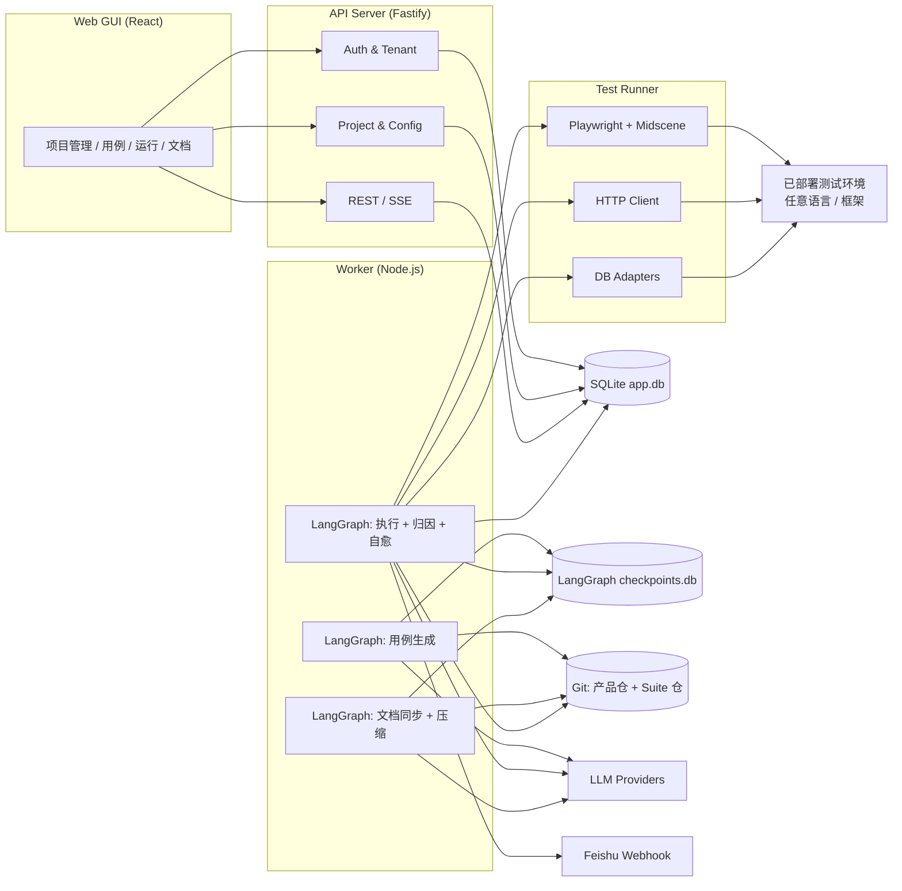

# git-ai-test-flow

> AI 驱动的 Git 变更测试平台：从提交差异识别功能点，生成可执行的 Gherkin 用例，在已部署最新代码的测试环境上完成 API / 数据库 / UI 端到端回归，并对失败进行归因、修复建议与飞书通知。

当前状态：**M1 工程基座已完成**（pnpm workspace、`apps/*`、`packages/*` 骨架、配置/日志/错误/加密基础库、SQLite 迁移基座、Fastify API 骨架、Worker 任务队列骨架、CI/测试基线与进度同步门禁已完成并通过退出验收），下一步进入 M2 认证与租户。产品设计、实施步骤与进度分别见下方开发文档。

## 解决的问题

AI 编程显著提升了提交频率，但测试环节仍然依赖人工补用例、手工造数、手工排查失败。`git-ai-test-flow` 将「变更分析 → 用例生成 → 环境准备 → 执行 → 失败归因 → 报告通知 → 文档同步」串成一条可审计的自动化流水线。

## 核心能力

- **变更驱动用例生成**：解析 Git diff、文档与 OpenAPI 变更，识别新增/修改的功能点，生成 Gherkin 风格用例；固定流程复用预置步骤，复杂场景交给带工具白名单的 Agent。
- **对已部署环境做端到端回归**：产品代码由外部 CI/CD 部署到测试环境，平台只连接环境 URL，校验实际部署版本，生成测试数据（可写数据库），执行历史用例与新增用例，支持 API、数据库与 UI 全链路验证。
- **语言/框架无关**：不要求被测项目可安装、可构建、可启动；Java、Go、Python、Node 等项目只要测试环境可访问即可接入。
- **前端视觉验证**：基于 Playwright + Midscene.js 完成页面截图、按钮点击、自然语言断言与失败证据采集。
- **失败归因与自修复**：规则优先、LLM 辅助、历史基线/多环境对比，区分代码缺陷、用例缺陷、环境问题与不稳定用例；仅对高置信用例缺陷自动修复，并受防「改测试迁就 Bug」的 guard 约束。
- **项目文档管理**：按模块生成描述文档，随提交增量更新；最近 100 次提交保留详细记录，更早历史分层压缩，原始条目可追溯。
- **多租户与安全配置**：租户隔离、RBAC、Git / LLM / 数据库 / 飞书凭据加密存储，执行环境沙箱与生产库保护。
- **GitHub 风格 GUI**：用户名密码登录，项目配置、用例审阅、运行详情、截图与 Trace、失败归因、文档历史一站查看。

## 计划架构



## 计划技术栈

| 层 | 选型 |
|---|---|
| 语言 / 工程 | Node.js 22、TypeScript、pnpm workspace |
| 后端 | Fastify、Zod、Drizzle ORM、better-sqlite3 |
| 编排 | LangGraph.js、SqliteSaver |
| 前端 | React、Vite、Tailwind CSS、antd、lucide-react |
| 测试运行时 | Playwright、Midscene.js、undici、@cucumber/gherkin |
| Git | simple-git + git CLI worktree |
| 数据库 | SQLite（平台自身）；MySQL / PostgreSQL / SQLite（被测项目造数） |
| 通知 | 飞书自定义机器人 Webhook |

## 本地开发

要求 Node.js 22.12+、pnpm 10+。

```bash
pnpm install
pnpm verify:workspace
pnpm lint
pnpm typecheck
pnpm test
pnpm test:coverage
pnpm build
pnpm db:migrate
pnpm check:deps
pnpm check:progress
pnpm format:check
pnpm audit:prod
```

`pnpm build` 先用 `tsc -b` 构建 Node 侧包与应用，再构建 Web；`pnpm test` 运行 Vitest 单测；`pnpm test:coverage` 额外生成覆盖率报告并校验阈值（语句/行/函数 ≥ 80%，分支 ≥ 70%）；`pnpm db:migrate` 应用 SQLite 迁移（默认 `./data/app.db`，可用 `DATABASE_PATH` 覆盖）；`pnpm check:deps` 校验 `apps → packages` 依赖方向；`pnpm audit:prod` 只审计生产依赖并以高危为失败阈值（开发依赖中的中危告警不阻塞）。

进度门禁：`pnpm check:progress` 默认校验暂存区，只要除 `docs/DEVELOPMENT_PROGRESS.md` 外还有改动、而进度文档未随之更新，就以退出码 1 拦截；`pnpm check:progress --base <ref>` 对比 `<ref>...HEAD`，供 CI 在 PR 上使用。`pnpm install` 会通过 `prepare` 安装 husky pre-commit 钩子，CI 的 verify job 也会在 PR 上执行同一检查。PR 模板位于 `.github/pull_request_template.md`。

E2E 由 Playwright 驱动（首次需执行 `pnpm exec playwright install chromium`）：

```bash
pnpm test:e2e
```

CI 工作流 `.github/workflows/ci.yml` 在 PR 与 `main` 推送时运行 lint、格式检查、类型检查、带覆盖率阈值的单测、构建、依赖方向检查、生产依赖审计与 Playwright 冒烟测试；PR 还会校验进度文档已随改动更新。

启动 API（会自动从当前目录向上查找 `.env`，因此仓库根目录的配置对 `--filter` 启动的进程同样生效）：

```bash
cp .env.example .env
node -e "console.log(require('node:crypto').randomBytes(32).toString('base64'))"
# 将输出写入 .env 的 ENCRYPTION_KEY，并把 SESSION_SECRET 改为 32 位以上随机串
pnpm --filter @gait/server dev
curl http://localhost:3000/healthz
```

`GET /healthz` 返回 `{"status":"ok","uptimeMs":...}`，响应头包含 `X-Request-Id`；错误响应统一为 RFC 7807 `application/problem+json`。

启动 Worker（消费 SQLite `jobs` 表；先执行迁移）：

```bash
pnpm db:migrate
pnpm --filter @gait/worker dev
# 或构建后运行：pnpm --filter @gait/worker start
```

Worker 与 API 共用同一套 `.env` 查找规则。Worker 通过 `DATABASE_PATH` 读取业务库、通过 `CHECKPOINT_DB_PATH` 初始化 LangGraph checkpoint 库，两者必须是不同文件（启动时校验，`:memory:` 除外）；轮询/租约/心跳由 `WORKER_POLL_INTERVAL_MS`、`WORKER_LEASE_MS`、`WORKER_HEARTBEAT_MS` 控制，且心跳必须小于租约。任务领取使用单条原子 `UPDATE ... RETURNING`，过期租约会被回收重排或标记失败。M1 仅注册 `noop` 任务类型用于验证消费链路。

依赖说明：根 `pnpm.overrides` 将 `better-sqlite3` 统一到 13.2.0；`@langchain/langgraph-checkpoint-sqlite` 声明的 12.x 缺少 Windows 预编译二进制，13.2.0 已验证兼容。根 `pnpm dev` 等多进程命令随里程碑逐步生效，参见[开发阶段与实施步骤](docs/DEVELOPMENT_PLAN.md)。

## 开发文档

- [开发项目描述文档](docs/PROJECT_SPEC.md) — 产品需求、架构、LangGraph 工作流、Gherkin 规范、数据模型、API、GUI、路线图
- [开发阶段与实施步骤](docs/DEVELOPMENT_PLAN.md) — M0-M10 分阶段任务、依赖、验收标准与提交规范
- [开发进度文档](docs/DEVELOPMENT_PROGRESS.md) — 当前阶段、步骤状态、总体进度；每次提交前同步
- [登录流程用例示例](docs/examples/login.feature)
- [Agent 复杂流程用例示例](docs/examples/instagram-post.feature)
- [API + 数据库断言用例示例](docs/examples/post-api.feature)

开发按 M0-M10 逐步推进，进度以 `docs/DEVELOPMENT_PROGRESS.md` 为准。

## 路线图

| 阶段 | 目标 |
|---|---|
| P0 | 多租户登录、项目/凭证/环境配置、Git diff → Gherkin、API/DB 执行、失败归因、报告与飞书、GitHub 风格基础 UI |
| P1 | UI 视觉测试、自修复循环与审批、文档生成/增量/压缩、Webhook、SSE、Docker runner |
| P2 | 多环境管理、PR/MR 集成、对象存储、配额计费、SSO、多 runner 扩展 |

## License

[MIT](LICENSE)
