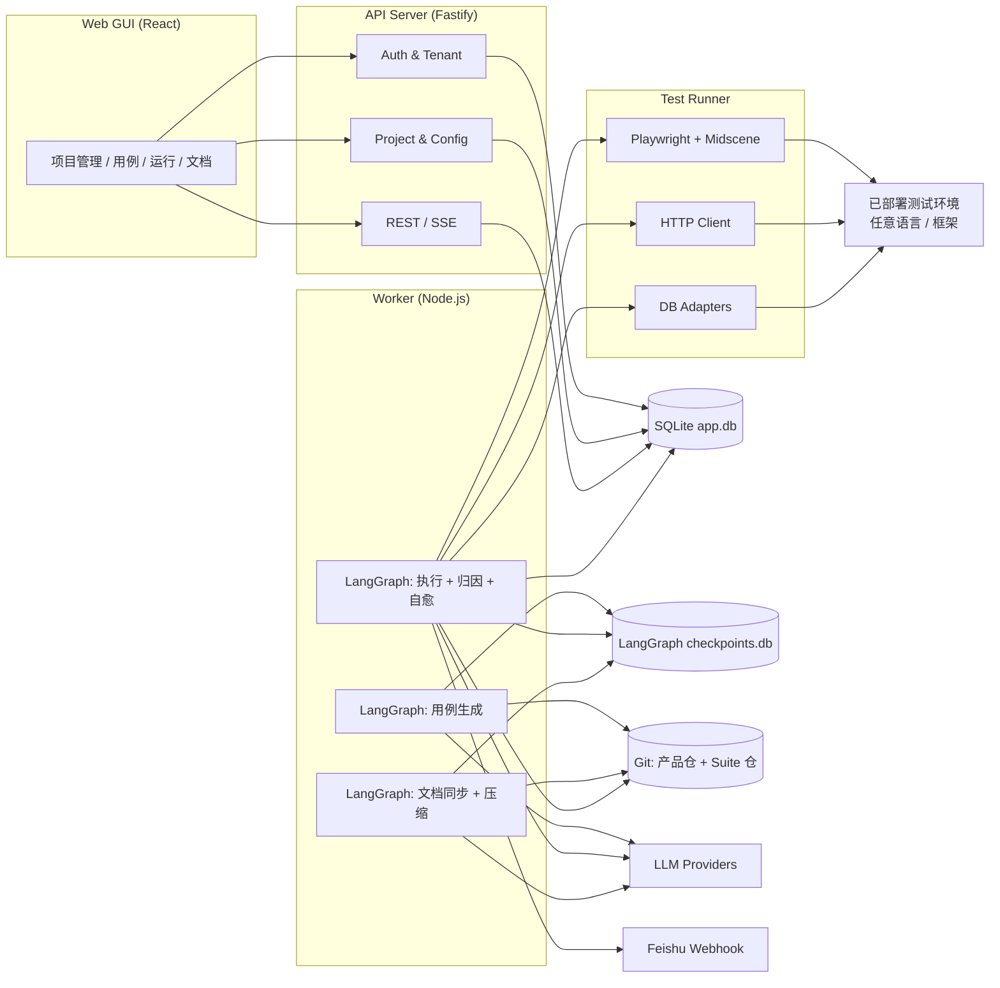

# git-ai-test-flow

> AI 驱动的 Git 变更测试平台：从提交差异识别功能点，生成可执行的 Gherkin 用例，在已部署最新代码的测试环境上完成 API / 数据库 / UI 端到端回归，并对失败进行归因、修复建议与飞书通知。

当前状态：**开发项目描述文档阶段**。本文档定义产品目标、系统架构、数据模型、接口与实现路线，作为后续编码的基线。

## 解决的问题

AI 编程显著提升了提交频率，但测试环节仍然依赖人工补用例、手工造数、手工排查失败。`git-ai-test-flow` 将「变更分析 → 用例生成 → 环境准备 → 执行 → 失败归因 → 报告通知 → 文档同步」串成一条可审计的自动化流水线。

## 核心能力

- **变更驱动用例生成**：解析 Git diff、文档与 OpenAPI 变更，识别新增/修改的功能点，生成 Gherkin 风格用例；固定流程复用预置步骤，复杂场景交给带工具白名单的 Agent。
- **对已部署环境做端到端回归**：产品代码由外部 CI/CD 部署到测试环境，平台只连接环境 URL，校验实际部署版本，生成测试数据（可写数据库），执行历史用例与新增用例，支持 API、数据库与 UI 全链路验证。
- **语言/框架无关**：不要求被测项目可安装、可构建、可启动；Java、Go、Python、Node 等项目只要测试环境可访问即可接入。
- **前端视觉验证**：基于 Playwright + Midscene.js 完成页面截图、按钮点击、自然语言断言与失败证据采集。
- **失败归因与自修复**：规则优先、LLM 辅助、历史基线/多环境对比，区分代码缺陷、用例缺陷、环境问题与不稳定用例；仅对高置信用例缺陷自动修复，并受防「改测试迁就 Bug」的 guard 约束。
- **项目文档管理**：按模块生成描述文档，随提交增量更新；最近 100 次提交保留详细记录，更早历史分层压缩，原始条目可追溯。
- **多租户与安全配置**：租户隔离、RBAC、Git / LLM / 数据库 / 飞书凭据加密存储，执行环境沙箱与生产库保护。
- **GitHub 风格 GUI**：用户名密码登录，项目配置、用例审阅、运行详情、截图与 Trace、失败归因、文档历史一站查看。

## 计划架构

## 计划技术栈

| 层 | 选型 |
|---|---|
| 语言 / 工程 | Node.js 22、TypeScript、pnpm workspace |
| 后端 | Fastify、Zod、Drizzle ORM、better-sqlite3 |
| 编排 | LangGraph.js、SqliteSaver |
| 前端 | React、Vite、Tailwind CSS、antd、lucide-react |
| 测试运行时 | Playwright、Midscene.js、undici、@cucumber/gherkin |
| Git | simple-git + git CLI worktree |
| 数据库 | SQLite（平台自身）；MySQL / PostgreSQL / SQLite（被测项目造数） |
| 通知 | 飞书自定义机器人 Webhook |

## 开发文档

- [开发项目描述文档](docs/PROJECT_SPEC.md) — 产品需求、架构、LangGraph 工作流、Gherkin 规范、数据模型、API、GUI、路线图
- [登录流程用例示例](docs/examples/login.feature)
- [Agent 复杂流程用例示例](docs/examples/instagram-post.feature)
- [API + 数据库断言用例示例](docs/examples/post-api.feature)

## 路线图

| 阶段 | 目标 |
|---|---|
| P0 | 多租户登录、项目/凭证/环境配置、Git diff → Gherkin、API/DB 执行、失败归因、报告与飞书、GitHub 风格基础 UI |
| P1 | UI 视觉测试、自修复循环与审批、文档生成/增量/压缩、Webhook、SSE、Docker runner |
| P2 | 多环境管理、PR/MR 集成、对象存储、配额计费、SSO、多 runner 扩展 |

## License

[MIT](LICENSE)
