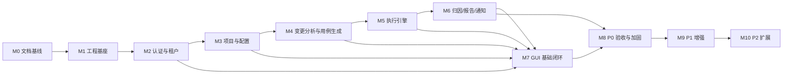

# git-ai-test-flow 开发阶段与实施步骤

> 本文是 [PROJECT_SPEC.md](./PROJECT_SPEC.md) 的执行版：把产品设计拆成可按顺序实施、可独立提交、可验证的开发步骤。
>
> 进度不在本文维护，统一记录在 [DEVELOPMENT_PROGRESS.md](./DEVELOPMENT_PROGRESS.md)。每次提交前必须同步进度文档。

## 文档信息

| 项 | 内容 |
|---|---|
| 文档版本 | v1.0 |
| 文档状态 | 执行基线 |
| 更新日期 | 2026-11-20 |
| 适用范围 | P0 / P1 / P2 |
| 目标读者 | 开发、测试、项目负责人 |
| 关联文档 | [开发项目描述文档](./PROJECT_SPEC.md)、[开发进度文档](./DEVELOPMENT_PROGRESS.md) |

### 版本记录

| 版本 | 日期 | 变更内容 | 作者 |
|---|---|---|---|
| v1.0 | 2026-11-20 | 初版：将 P0/P1/P2 拆分为 M0-M10，共 83 个可执行步骤 | 项目组 |

---

## 1. 实施策略

### 1.1 核心原则

1. **P0 垂直闭环优先**：先用最小能力跑通「登录 → 配置项目/环境 → 解析 diff → 生成用例 → 在已部署环境执行 API/DB → 归因 → 报告/飞书」，再补 UI 视觉、自修复、文档压缩等增强。
2. **先契约后实现**：DTO、Zod schema、数据库表、API 路径、Step 协议先定，再写实现；前后端共享 `packages/shared`。
3. **测试随步骤提交**：每个步骤至少包含单元测试或集成测试；关键链路必须有 E2E 或手工验收记录。
4. **多租户与安全前置**：`tenant_id` 从会话派生、仓储强制过滤、凭据加密、审计日志从 M1/M2 开始建设，不后补。
5. **平台不执行产品代码**：不安装、不构建、不启动被测项目；Runner 只通过 HTTP、浏览器、数据库访问外部已部署测试环境。
6. **确定性优先**：用例优先使用 builtin/template/script/api/db 步骤；`[agent]` 只用于无法确定性表达的复杂流程。
7. **小步提交、可回滚**：每个 Step 对应一个 commit；数据库迁移只前进、不回滚；高风险能力用配置开关控制。
8. **文档与进度同步**：代码、接口、配置变更同步更新描述文档；每次提交前更新进度文档，并与代码放入同一 commit。

### 1.2 交付主线



- **关键路径**：M1 → M2 → M3 → M4 → M5 → M6 → M8。
- **并行路径**：M7 可在 M2 完成后开始，随 API 逐步补齐页面；M8 的安全、部署工作可与 M6/M7 并行。
- **禁止跳步**：M5 依赖 M4 的 Gherkin 解析与 Suite 抽象；M6 依赖 M5 的 Run/Step 结果；M9 的文档管理依赖 M4 的 Git 与用例索引。

### 1.3 分支、提交与评审

| 项 | 规范 |
|---|---|
| 主分支 | `main` 保持可运行、可验收；不在 `main` 直接开发 |
| 功能分支 | `feature/M1-S1-workspace-init` |
| 修复分支 | `fix/M5-S2-version-header-parse` |
| Commit 格式 | `feat(m1): 初始化 pnpm workspace [M1-S1]` |
| Commit 类型 | `feat` / `fix` / `refactor` / `test` / `docs` / `chore` / `ci` |
| Commit 内容 | 代码 + 测试 + 相关文档 + 进度文档，一次提交完成 |
| PR 要求 | 关联 Step ID；说明验证命令与结果；无未修复的 medium 及以上缺陷 |
| Merge 策略 | Squash merge 到 `main`，PR 标题即最终 commit 标题 |

**提交示例**

```text
feat(m1): 初始化 pnpm workspace 与基础脚本 [M1-S1]

- 新增 pnpm-workspace.yaml、根 package.json、tsconfig.base.json
- 配置 ESLint、Prettier、Vitest
- 更新 docs/DEVELOPMENT_PROGRESS.md

Co-Authored-By: Claude Code <noreply@anthropic.com>
```

### 1.4 Step 完成定义（DoD）

一个 Step 只有同时满足以下条件才能标记 `DONE`：

- [ ] 代码已实现，类型检查通过；
- [ ] 单元测试/集成测试覆盖主路径与关键异常路径；
- [ ] 涉及接口、配置、数据模型、执行行为的，已同步更新 `PROJECT_SPEC.md`；
- [ ] 已在 `DEVELOPMENT_PROGRESS.md` 填写状态、日期、提交、验证结果；
- [ ] 无明文密钥、无敏感日志、无跨租户越权；
- [ ] 安全相关变更已记录审计事件；
- [ ] `pnpm lint`、`pnpm typecheck`、`pnpm test` 通过（不适用的步骤需在进度文档说明原因）；
- [ ] 需要手工验收的步骤已附验收记录或截图。

### 1.5 估算与进度计算

- 人日按**单人开发**估算；P0 假设 1-2 名开发并行，8-10 周完成。
- 里程碑权重用于计算总体进度，P0 合计 60%，P1 合计 27%，P2 合计 13%。

| 里程碑 | 权重 |
|---|---:|
| M0 文档基线 | 2% |
| M1 工程基座 | 6% |
| M2 认证与租户 | 6% |
| M3 项目与配置 | 7% |
| M4 变更分析与用例生成 | 11% |
| M5 执行引擎 | 11% |
| M6 归因/报告/通知 | 7% |
| M7 GUI 基础闭环 | 5% |
| M8 P0 验收与加固 | 5% |
| M9 P1 增强 | 27% |
| M10 P2 扩展 | 13% |
| **合计** | **100%** |

**总体进度公式**

```text
总体进度 = Σ(里程碑权重 × 里程碑已完成步骤数 / 里程碑总步骤数)
```

- 步骤状态为 `DONE` 才计入完成数；`VERIFY`（待验证）不计入。
- 同一里程碑内步骤默认等权；若某步骤明显更大，可在进度文档备注，但不得私自调整里程碑权重。
- 权重调整必须升级本文档版本，并同步更新进度文档的基准。

---

## 2. 工程基线

### 2.1 技术基线

| 项 | 基线 |
|---|---|
| 运行时 | Node.js 22 LTS |
| 包管理 | pnpm 10+ workspace |
| 语言 | TypeScript 5.x，`strict: true` |
| API | Fastify + Zod |
| 数据库 | SQLite 3.40+，WAL；Drizzle ORM + better-sqlite3 |
| 编排 | LangGraph.js + SqliteSaver |
| Gherkin | @cucumber/gherkin |
| HTTP 客户端 | undici |
| UI 自动化 | Playwright Chromium；P1 增加 @midscene/web |
| 前端 | React + Vite + Tailwind CSS + antd + lucide-react |
| 测试 | Vitest + Playwright Test |
| 日志 | pino |
| CI | GitHub Actions |
| 包作用域 | `@gait/*`（Git AI Test） |

### 2.2 计划命令

| 命令 | 用途 | 引入阶段 |
|---|---|---|
| `pnpm install` | 安装依赖 | M1-S1 |
| `pnpm dev` | 启动 API + Web + Worker | M1-S5/M2-S8 |
| `pnpm build` | 构建全部应用与包 | M1-S2 |
| `pnpm lint` | ESLint + 格式检查 | M1-S1 |
| `pnpm typecheck` | TypeScript 全量类型检查 | M1-S2 |
| `pnpm test` | Vitest 单元/集成测试 | M1-S7 |
| `pnpm test:e2e` | Playwright E2E | M7-S7 |
| `pnpm db:generate` | 生成 Drizzle 迁移 | M1-S4 |
| `pnpm db:migrate` | 执行迁移 | M1-S4 |
| `pnpm admin:create` | 创建首个平台管理员 | M2-S3 |
| `pnpm runner:dev` | 独立 Runner 调试（可选） | M5-S1 |
| `pnpm check:progress` | 校验进度文档是否随提交更新 | M1-S8 |

### 2.3 环境变量

| 变量 | 用途 | 必填 |
|---|---|---|
| `NODE_ENV` | 运行环境 | 是 |
| `PORT` | API 端口，默认 3000 | 否 |
| `DATA_DIR` | 数据根目录，默认 `./data` | 否 |
| `DATABASE_PATH` | 应用库路径，默认 `./data/app.db` | 否 |
| `CHECKPOINT_DB_PATH` | LangGraph checkpoint 路径，默认 `./data/checkpoints/checkpoints.db` | 否 |
| `ENCRYPTION_KEY` | 凭据 AES-256-GCM 主密钥（base64） | 是 |
| `ENCRYPTION_KEY_VERSION` | 密钥版本，支持轮换 | 否 |
| `SESSION_SECRET` | 会话签名/CSRF 辅助密钥 | 是 |
| `PUBLIC_BASE_URL` | 报告/通知中的外链基地址 | 是 |
| `LOG_LEVEL` | pino 日志级别 | 否 |
| `SSRF_ALLOWLIST` | 允许访问的内网测试环境主机 | 否 |
| `RUNNER_CONCURRENCY` | Runner 并发上限 | 否 |

> 真实密钥只放在本地 `.env` 或部署平台 Secret，不提交仓库；`.env.example` 只放占位符。

### 2.4 本地运行拓扑

```text
Browser
  └─ Web (Vite, :5173)
       └─ API Server (Fastify, :3000)
            ├─ data/app.db
            ├─ data/checkpoints/checkpoints.db
            ├─ data/artifacts/
            └─ jobs 表
                 └─ Worker (Node)
                      ├─ LangGraph 图 A/B/C
                      ├─ LLM Provider
                      └─ Runner (同进程或独立进程)
                           ├─ HTTP -> 已部署测试环境 API
                           ├─ Playwright -> 已部署测试环境 Web
                           └─ DB Adapter -> 测试数据库
```

### 2.5 测试策略

| 层级 | 覆盖对象 | 工具 | 要求 |
|---|---|---|---|
| 单元测试 | 加密、diff 解析、StepRegistry、guard、状态机、压缩算法 | Vitest | 核心纯函数覆盖率 ≥ 80% |
| 集成测试 | API + SQLite、任务队列、LangGraph（假 LLM）、Runner | Vitest | 每个 API 模块至少一条主路径 + 越权/异常路径 |
| 契约测试 | DTO/Zod、OpenAPI 式请求响应 | Vitest | 前后端共享 schema，不重复定义 |
| E2E | 登录、配置、生成审批、运行查看 | Playwright Test | P0 关键链路全覆盖 |
| 安全测试 | 跨租户、SSRF、路径穿越、凭据搬运、prompt injection | Vitest + 脚本 | 每次 P0 验收必跑 |
| 验收测试 | 预部署 demo-app 环境 | 手工 + Runner | 记录 Run、报告、截图/Trace |

---

## 3. 里程碑总览

| 里程碑 | 阶段 | 目标 | 主要交付 | 退出标准 | 预估 | 依赖 | 规范章节 |
|---|---|---|---|---|---|---|---|
| M0 | P0 | 固化需求与执行基线 | 规格、示例、开发计划、进度文档 | 文档评审通过，链接/结构校验通过 | 已完成 | 无 | 全篇 |
| M1 | P0 | 可运行的 monorepo 基座 | workspace、配置、日志、错误、加密、DB、API/Worker 骨架、CI | `pnpm lint/typecheck/test/build` 通过；API 健康检查可用 | 9 人日 | M0 | 6、7、8、17、20 |
| M2 | P0 | 登录、租户与 RBAC | 用户/租户/会话/成员/审计、登录页 | 登录/退出/切租户可用；跨租户 404 | 8.5 人日 | M1 | 8、18.2、19 |
| M3 | P0 | 项目与基础配置 | 项目、Git 凭据、LLM、环境、飞书、测试连接 | 全部配置可保存、可测试、密钥掩码 | 8.5 人日 | M2 | 9、17、18.2 |
| M4 | P0 | diff → 功能点 → Gherkin | Git 解析、Suite 抽象、Graph A、校验、审批 | 3 个提交生成 ≥ 10 个可执行场景 | 14.5 人日 | M3 | 10、11、16.2 |
| M5 | P0 | 已部署环境执行引擎 | 工作区、版本校验、造数、API/DB/基础 UI 执行、产物 | API/DB/基础 UI 端到端跑通；记录 deployedSha | 14.5 人日 | M4 | 12、16.3 |
| M6 | P0 | 归因、报告与飞书 | 证据、规则/LLM 归因、报告、通知 | 区分 code_bug/test_bug/env_issue；飞书可用 | 9.5 人日 | M5 | 13、14、16.3 |
| M7 | P0 | GitHub 风格 GUI 闭环 | 登录、项目、生成审批、运行详情、证据查看 | 核心流程全部可在 GUI 完成 | 10 人日 | M2-M6 | 19 |
| M8 | P0 | 验收、安全与交付 | demo-app 环境、安全加固、部署、验收报告 | P0 验收清单全部通过；发布 v0.1.0 | 7.5 人日 | M6、M7 | 20、21 |
| M9 | P1 | UI 视觉、自修复、文档管理、SSE、Docker runner | Midscene、修复循环、文档压缩、Webhook、项目 RBAC | P1 退出标准通过 | 6-8 周 | M8 | 4、13、15、16.4、19 |
| M10 | P2 | 多环境、PostgreSQL、CI 集成、扩展 | 多环境、Postgres、PR 集成、S3、SSO、多 runner、插件 | P2 退出标准通过 | 8 周+ | M9 | 22 |

---

## 4. 分阶段实施步骤

### 4.1 M0 文档基线（P0，已完成）

**目标**：冻结 v0.2 产品设计，形成可执行的开发计划与进度基线。

**前置**：无。

**退出标准**：规格、示例、README、开发计划、进度文档齐全；结构、链接、旧字段、密钥扫描通过。

| Step | 工作内容 | 主要产物 | 验证 | 预估 |
|---|---|---|---|---|
| M0-S1 | 需求、架构、数据模型、API、验收标准 | `docs/PROJECT_SPEC.md` | 24 章齐全；代码围栏/Mermaid/链接校验 | 已完成 |
| M0-S2 | 登录、Agent、API+DB 示例；README 索引 | `docs/examples/*.feature`、`README.md` | Gherkin 可解析；相对链接有效 | 已完成 |
| M0-S3 | 开发阶段拆分、进度模板、提交门禁说明 | `docs/DEVELOPMENT_PLAN.md`、`docs/DEVELOPMENT_PROGRESS.md`、`CLAUDE.md` | 步骤 ID 与进度表一致；维护规则可执行 | 已完成 |

**关键约束**

- 本文与 `PROJECT_SPEC.md` 冲突时，以规格为准，并先修订规格再修订计划。
- 计划中的步骤 ID 一旦进入进度文档，不得随意重命名；确需调整时保留旧 ID 并注明迁移。

---

### 4.2 M1 工程基座（P0）

**目标**：建立可安装、可构建、可测试、可启动的 monorepo 基座，为后续业务模块提供统一配置、日志、错误、加密、数据库、API/Worker 与 CI。

**前置**：M0 完成。

**退出标准**：

- `pnpm install`、`pnpm lint`、`pnpm typecheck`、`pnpm test`、`pnpm build` 全部通过；
- API `GET /healthz` 返回 200；Worker 能领取并完成一个空任务；
- SQLite 迁移可重复执行；`app.db` 与 `checkpoints.db` 分离；
- CI 在 PR 上运行 lint/typecheck/test/build；
- `pnpm check:progress` 能拦截未同步进度文档的代码提交。

| Step | 工作内容 | 主要产物 | 验证 | 预估 |
|---|---|---|---|---|
| M1-S1 | 初始化 pnpm workspace、根脚本、TS/ESLint/Prettier、`.gitignore`、`.env.example` | 根 `package.json`、`pnpm-workspace.yaml`、`tsconfig.base.json`、配置文件 | `pnpm install`、`pnpm lint` | 1d |
| M1-S2 | 建立 `apps/server`、`apps/web`、`apps/worker`、`packages/*` 骨架与依赖边界 | 各包 `package.json`、入口文件、构建配置、`dependency-cruiser` | `pnpm build`、`pnpm typecheck`、依赖方向检查 | 1d |
| M1-S3 | `packages/config`：环境变量 Zod、pino、RFC 7807 错误、AES-256-GCM、UUIDv7、时间工具 | 配置/日志/错误/加密模块与单测 | 单测覆盖加密往返、错误序列化、环境校验 | 1d |
| M1-S4 | `packages/db`：Drizzle schema 基座、迁移器、SQLite PRAGMA、测试库工具 | schema、迁移、Repository 基类、测试 helper | `pnpm db:migrate` 可重复执行；WAL/外键生效 | 1.5d |
| M1-S5 | Fastify API 骨架：健康检查、请求 ID、错误处理、Cookie/CSRF、优雅退出 | `apps/server` 可启动 | `curl /healthz`；集成测试 | 1d |
| M1-S6 | Worker 骨架：`jobs` 表、租约/心跳、优雅退出、checkpoint 初始化 | `apps/worker` 可消费任务 | 领取/完成/超时回收测试 | 1d |
| M1-S7 | Vitest/Playwright 配置、GitHub Actions、覆盖率与依赖审计 | 测试配置、CI workflow | PR 上 CI 全绿 | 1.5d |
| M1-S8 | 进度同步门禁：`check:progress` 脚本、pre-commit/CI 校验、提交模板 | `scripts/check-progress.mjs`、hook、PR 模板 | 暂存代码但未改进度文档时被拦截 | 1d |

**实施要点**

- 包命名统一 `@gait/shared`、`@gait/config`、`@gait/db`、`@gait/git`、`@gait/agent`、`@gait/runner`、`@gait/docs`。
- 依赖方向遵守规格 6.4：`apps → packages/agent → packages/runner → packages/git → packages/db → packages/shared → packages/config`，禁止循环依赖。
- 数据库迁移只前进；每个迁移文件必须有对应测试库初始化验证。
- `data/` 加入 `.gitignore`；`data/.gitkeep` 可保留目录结构。
- 日志统一结构化字段：`requestId`、`tenantId`、`projectId`、`runId`、`jobId`、`durationMs`；不记录密钥、Cookie、Authorization。

**提交拆分建议**

```text
chore(m1): 初始化 pnpm workspace [M1-S1]
chore(m1): 建立应用与共享包骨架 [M1-S2]
feat(m1): 新增配置、日志、错误与加密基础库 [M1-S3]
feat(m1): 新增数据库 schema、迁移与测试库工具 [M1-S4]
feat(m1): 新增 Fastify API 骨架与健康检查 [M1-S5]
feat(m1): 新增 Worker 任务消费骨架 [M1-S6]
ci(m1): 新增测试、构建与依赖边界检查 [M1-S7]
chore(m1): 新增开发进度同步门禁 [M1-S8]
```

**风险与应对**

- **过早引入复杂构建工具**：优先 `tsc -b` + `tsx` + Vite，避免多层 bundler。
- **SQLite 锁冲突**：应用库与 checkpoint 库分离；写操作串行；设置 `busy_timeout`。
- **依赖边界失控**：M1-S2 即接入 `dependency-cruiser`，CI 阻断循环依赖。

---

### 4.3 M2 认证与租户（P0）

**目标**：实现用户名密码登录、会话、租户切换、RBAC、成员管理与审计，确保所有后续接口都具备租户隔离能力。

**前置**：M1 完成。

**退出标准**：

- 可创建首个管理员并登录；登录/退出/修改密码可用；
- 会话 Cookie 为 `HttpOnly + SameSite=Lax`；变更请求校验 CSRF；
- OWNER/ADMIN/DEVELOPER/VIEWER 权限矩阵可测试；
- 跨租户访问统一 404；普通成员不能读取或修改凭据；
- 认证与租户变更写入审计日志。

| Step | 工作内容 | 主要产物 | 验证 | 预估 |
|---|---|---|---|---|
| M2-S1 | `tenants`、`users`、`tenant_members`、`sessions` 表与仓储 | schema、迁移、Repository | 仓储强制 tenant 过滤的单测 | 1d |
| M2-S2 | 登录/登出/当前用户/修改密码；argon2id；会话 token 哈希存储 | `/auth/*`、`/me*` API | 登录、过期、错误密码、CSRF 测试 | 1.5d |
| M2-S3 | 首个管理员 CLI；禁止匿名注册 | `pnpm admin:create` | CLI 创建后可登录；重复创建被拒绝 | 0.5d |
| M2-S4 | RBAC 权限点与 Fastify 守卫；tenant 上下文只从会话派生 | 权限矩阵、`requirePermission` | 角色矩阵集成测试 | 1d |
| M2-S5 | 租户成员列表/新增/改角色/移除；最后 OWNER 保护 | 成员管理 API | 成员生命周期测试 | 1d |
| M2-S6 | 审计日志：登录、失败登录、切租户、成员变更 | `audit_logs` 写入与查询 | 审计事件断言 | 1d |
| M2-S7 | 跨租户、会话固定、CSRF、限流集成测试 | 安全测试用例 | 跨租户 100% 404 | 1.5d |
| M2-S8 | 最小登录页、应用外壳、会话守卫、租户切换器 | React 登录/布局 | 手工登录并切换租户 | 1d |

**实施要点**

- 会话 token 为 32 字节随机值，数据库只存 SHA-256 哈希；Cookie 名 `gait_session`。
- `activeTenantId` 存在会话中；所有业务查询的 `tenant_id` 来自会话与 membership，绝不信任请求体/查询参数。
- 密码使用 argon2id，参数按 OWASP 建议配置；登录限流按 IP + 用户名。
- 平台管理员 `is_platform_admin` 只用于平台运维，不绕过租户数据隔离；跨租户运维必须走审计化的管理接口。
- 审计日志 append-only；敏感字段脱敏后写入。

**风险与应对**

- **权限点过粗**：先按「租户管理、成员管理、项目配置、凭据、生成、运行、文档、审计」划分，后续按页面细化。
- **会话与 CSRF 复杂度**：使用成熟插件/模式，写清楚 double-submit 流程与测试。

---

### 4.4 M3 项目与配置（P0）

**目标**：完成项目、Git 凭据、LLM、测试环境、飞书渠道的配置能力，并提供「测试连接」与安全存储。

**前置**：M2 完成。

**退出标准**：

- 项目 CRUD、Git 凭据、LLM Profile、Environment Profile、飞书渠道均可配置；
- 所有密钥 AES-256-GCM 加密存储，API 只返回掩码；
- Git/LLM/环境/飞书「测试连接」有明确成功/失败状态；
- 生产数据库连接默认拒绝；内网环境需显式允许；
- 配置变更写入审计日志。

| Step | 工作内容 | 主要产物 | 验证 | 预估 |
|---|---|---|---|---|
| M3-S1 | 项目 CRUD、slug 唯一、Suite 模式、默认分支、feature/docs 根目录 | `/projects` API | 项目生命周期与租户隔离测试 | 1d |
| M3-S2 | Git 凭据加密存储、掩码、轮换；Git 连通性测试 | `/credentials`、`test-connection` | `git ls-remote` 成功/失败；密文不可逆 | 1.5d |
| M3-S3 | LLM Profile：generation/triage/docs/vision 用途、OpenAI 兼容、连通性测试 | `/llm-profiles` API | 假 LLM 服务测试；健康状态 | 1d |
| M3-S4 | Environment Profile：API/Web URL、健康检查、版本来源、测试账号、DB、浏览器、超时 | `/environments` API | 环境健康/版本解析/SSRF 允许列表测试 | 1.5d |
| M3-S5 | 飞书渠道：Webhook/Secret 加密、事件选择、测试卡片、签名 | `/notification-channels` API | 签名计算与测试发送 | 1d |
| M3-S6 | 配置校验、脱敏、审计、生产库拒绝、危险开关二次确认 | 校验器、审计事件 | 密钥不回显；生产库连接被拒绝 | 1d |
| M3-S7 | 配置模块集成测试：租户隔离、加密落库、连接失败错误码 | 集成测试 | 全部配置 API 主/异常路径 | 1.5d |

**实施要点**

- 凭据 AAD 绑定 `tenantId/projectId/purpose/keyVersion`，防止密文搬运。
- Git 凭据测试使用临时 `GIT_ASKPASS` 脚本，进程结束立即删除；日志不输出 token。
- Environment Profile 的 `versionSource` 支持 `manual` / `header` / `endpoint`；`endpoint` 使用 JSONPath 解析 `deployedSha`。
- 健康检查与版本接口访问必须经过 SSRF 校验；默认拒绝私网/link-local/云元数据，内网测试环境由管理员加入允许列表。
- 飞书签名：`base64(HMAC-SHA256(key=timestamp+"\n"+secret, data=""))`；发送失败可重试，记录响应状态。

**风险与应对**

- **凭据泄漏**：密文、掩码、日志脱敏、审计、密钥轮换五件套同时上线。
- **环境配置复杂**：M3 只做配置与连通性，不执行用例；执行逻辑放 M5，避免过早耦合。

---

### 4.5 M4 变更分析与用例生成（P0）

**目标**：实现 `git diff → 过滤/分类 → 功能点 → 检索已有用例 → 生成 Gherkin → 校验/评审 → 人工审批 → 提交 Suite` 的完整链路。

**前置**：M3 完成。

**退出标准**：

- 支持 `current` 与 `range` 两种 diff；过滤锁文件、构建产物、二进制、生成文件；
- 3 个提交可生成 ≥ 10 个场景，100% 通过语法与 StepRegistry 干跑；
- 重复生成不产生重复用例；过时用例标记 `obsolete`，不物理删除；
- 生成结果可在 GUI/API 审阅、编辑、批准/拒绝；
- 批准后提交到 Suite 仓库，并更新索引与溯源标签。

| Step | 工作内容 | 主要产物 | 验证 | 预估 |
|---|---|---|---|---|
| M4-S1 | Git mirror/worktree、提交解析、`current/range` diff、`--unified=3` | `packages/git` | fixture 仓库 diff 黄金测试 | 1.5d |
| M4-S2 | 文件过滤、二进制/大文件处理、变更分类、文档/OpenAPI 识别 | diff 过滤器、分类器 | 过滤规则单测；截断记录 | 1d |
| M4-S3 | 逐文件摘要、功能点提取/聚合、源码引用、风险级别 | 功能点提取器 | 假 LLM 结构化输出测试 | 1.5d |
| M4-S4 | Suite 仓库抽象：managed/external/same_repo；分支、提交、幂等 | `SuiteRepository` | 三种模式读写测试；重复提交幂等 | 1.5d |
| M4-S5 | Gherkin 解析、Tag 规范、`[agent]` 识别、变量插值、StepRegistry 干跑 | Gherkin 解析/校验模块 | 示例 `.feature` 全部可解析 | 1.5d |
| M4-S6 | 已有用例检索（FTS5 + 模块 tag + 内容哈希）、覆盖判断 | 用例索引、检索 API | 已覆盖/需修改/新增/过时判断测试 | 1d |
| M4-S7 | Graph A：collect/filter/summarize/extract/retrieve/design/validate/critique/approval/commit | LangGraph 图 A | 假 LLM 端到端；中断恢复 | 2d |
| M4-S8 | 校验器：语法、未知 step、tag、secret、重复、断言充分性；critique 重写 ≤ 2 次 | 校验报告、critique prompt | 不合格草稿不得提交 | 1.5d |
| M4-S9 | 审批 API 与 Suite 提交：diff 预览、approve/edit/reject、提交信息、索引更新 | `/generations/*` API | 审批后 Suite 出现新 commit | 1.5d |
| M4-S10 | 生成链路测试与 golden cases：3 个提交、重复生成、无变更 no-op | 测试夹具、验收记录 | ≥ 10 场景；可执行率 100% | 1d |

**实施要点**

- diff2test 逻辑：`git diff --unified=3`、按文件拆分、过滤测试/生成/锁文件、逐文件构造 prompt；Node.js 重写时保留「逐文件摘要 + 汇总」两阶段，避免大 diff 超上下文。
- 生成器只生成 `.feature` 与 fixture 声明，不生成/修改 `steps/`、`templates/` 中的可执行代码；缺少 step 时输出「step 需求提案」。
- `[agent]` 步骤必须可解析、可校验；`When [agent]` 后必须有 `Then`；生成阶段不执行 Agent。
- 每个功能点至少引用一个源码文件与 hunk；文档/OpenAPI 变更作为补充语义来源。
- 用例指纹：`module + case key + scenario name + normalized steps`；内容哈希用于幂等提交。
- 过时用例标记 `@obsolete` 或状态字段，保留 Git 历史，不物理删除。

**风险与应对**

- **LLM 生成不可执行**：StepRegistry 干跑 + 规则校验先行；不合格回退重写，仍不合格则拒绝提交。
- **生成用例重复**：内容哈希 + 场景指纹 + 已有用例检索三重去重。
- **大 diff 上下文溢出**：按文件过滤/截断、逐文件摘要、分批生成，记录被截断文件。

---

### 4.6 M5 执行引擎（P0）

**目标**：对外部已部署测试环境执行 Gherkin 用例，覆盖工作区、环境健康/版本校验、测试数据、API、数据库、基础 UI（Playwright 确定性操作 + 截图/Trace）、产物采集与 Run 编排。

**前置**：M4 完成。

**退出标准**：

- 每次 Run 校验环境健康并记录 `deployedSha`；版本不一致标记 `environment_version_mismatch`；
- MySQL/PostgreSQL/SQLite 造数与断言可用；生产库默认拒绝；
- API 步骤支持状态码、JSONPath、JSON Schema、响应头断言，并可校验数据库；
- 基础 UI 步骤可通过 Playwright 访问已部署页面、点击、输入、截图、Trace；
- 同一项目并发 Run 使用独立数据命名空间；取消可中止 HTTP/浏览器/脚本；
- 50 条 API 回归 ≤ 15 分钟（本地/测试环境基线）。

| Step | 工作内容 | 主要产物 | 验证 | 预估 |
|---|---|---|---|---|
| M5-S1 | Run 工作区：Suite worktree、产品源码只读 checkout、临时目录、清理 | `packages/runner/workspace` | 目录隔离/清理/磁盘配额测试 | 1d |
| M5-S2 | 环境健康与版本校验：healthcheck、header/endpoint/manual、strict 模式、SSRF | `verify_environment` 模块 | 版本一致/不一致/不可达测试 | 1.5d |
| M5-S3 | DB 适配器：MySQL/PostgreSQL/SQLite、连接测试、fixtures、命名空间、清库 | `packages/runner/db` | 三库造数/清理/只读护栏测试 | 2d |
| M5-S4 | HTTP 执行器：undici、base URL、认证、变量插值、状态/JSONPath/JSON Schema/头断言 | `packages/runner/http` | 假 API 全断言测试 | 1.5d |
| M5-S5 | DB 步骤与断言：参数化查询、行数/结果集、快照 | DB step executor | SQL 注入防护、结果断言测试 | 1d |
| M5-S6 | StepRegistry：builtin/template/script/api/db/ui；登录模板；脚本子进程约束 | StepRegistry、模板库 | 示例 feature 全 step 执行 | 1.5d |
| M5-S7 | Run 编排：状态机、选择、并发、环境互斥、超时、取消、重试 | Run orchestrator | 并发/取消/超时测试 | 1.5d |
| M5-S8 | 产物采集：API 请求响应、DB 快照、截图/Trace/console、脱敏、保留策略 | Artifact collector | 产物可访问；敏感字段脱敏 | 1d |
| M5-S9 | Graph B 执行主链：prepare/verify/prepare_data/discover/fan_out/run_case/aggregate | LangGraph 图 B 执行部分 | 假环境端到端；checkpoint 恢复 | 2d |
| M5-S10 | API/DB/基础 UI 端到端验收；环境不可达快速失败 | 验收记录、Run 报告 | 50 条 API 回归 ≤ 15 分钟 | 1.5d |

**实施要点**

- 平台不执行产品仓库的 install/build/start/test；`product/` 仅用于 diff/上下文读取。
- 环境健康检查失败立即终止，归因 `env_issue`，不进入用例修复。
- 版本比对：`deployedSha` 与 `headSha` 不一致时默认告警继续，`strictVersionMatch=true` 阻断；Run/报告展示两者。
- DB 写入护栏：环境标记 `isTest=true` 才允许写；默认只读；只允许参数化 DML；禁止 DDL；生产库黑名单/二次确认；操作审计；teardown 必须执行。
- 并发：同一环境默认串行或受限并发；不同 Run 使用唯一 schema/前缀/命名空间；环境级互斥锁。
- 取消：AbortController 中止 HTTP；关闭浏览器上下文；终止脚本子进程树；记录已执行步骤。
- 基础 UI 在 P0 用 Playwright 确定性步骤；Midscene 视觉 Agent 放 M9-S1。

**风险与应对**

- **环境版本漂移**：Run 开始即解析版本；报告显式展示；严格模式供发布门禁使用。
- **测试数据污染**：唯一命名空间 + teardown + 失败现场保留；禁止跨 Run 复用数据。
- **脚本步骤风险**：仅允许 Suite 仓库受版本管理的脚本；子进程超时、环境变量白名单、无主机敏感挂载。

---

### 4.7 M6 归因、报告与飞书（P0）

**目标**：对失败用例收集证据，区分 `code_bug / test_bug / env_issue / flaky / unknown`，生成可追溯报告，并通过飞书通知。

**前置**：M5 完成。

**退出标准**：

- 每个失败用例有证据包：失败步骤、期望/实际、日志、API/DB 证据、截图/Trace（UI）、相关 diff；
- 规则优先 + LLM 辅助，输出有置信度与证据引用；证据不足归 `unknown`；
- 代码 Bug 不自动修改测试；P0 只生成修复建议；
- 报告包含目标 commit、环境部署版本、用例版本、失败分类、代码文件/行候选；
- 飞书卡片可送达、幂等、深链可打开；密钥/敏感字段脱敏。

| Step | 工作内容 | 主要产物 | 验证 | 预估 |
|---|---|---|---|---|
| M6-S1 | 证据包构建：StepResult、API、DB、日志、diff、历史结果、脱敏 | `EvidencePack` | 证据完整性与脱敏测试 | 1d |
| M6-S2 | 规则归因引擎：环境/版本/DB/历史/重跑/断言关联矩阵 | 规则矩阵 | 规格 13.2 全矩阵单测 | 1d |
| M6-S3 | LLM 归因：prompt、Zod schema、置信度、证据引用、失败回退 `unknown` | 归因模块 | 假 LLM 结构化输出/重试测试 | 1d |
| M6-S4 | flaky 判定：失败用例重跑 1 次；区分稳定失败/偶发 | 重跑策略 | 重跑通过→flaky 测试 | 1d |
| M6-S5 | 修复建议与 guard：安全修复分类、禁止改 steps/删场景/弱化断言；P0 仅建议 | 修复提案、guard | guard 规则单测；不自动改产品代码 | 1d |
| M6-S6 | 报告生成：JSON/Markdown/HTML、JUnit 导出、代码引用、复现入口 | 报告生成器 | 报告快照测试；链接有效 | 1.5d |
| M6-S7 | 飞书通知：交互卡片、签名、幂等、重试、深链、脱敏 | 通知模块 | 假 Webhook 幂等/重试测试 | 1d |
| M6-S8 | Graph B 归因闭环：classify → decide → report → notify | LangGraph 图 B 完整 | 失败用例端到端 | 1d |
| M6-S9 | 归因/报告/通知集成测试与验收记录 | 测试、验收报告 | 代码 Bug 与用例 Bug 可区分 | 1d |

**实施要点**

- 归因顺序：规则 → LLM → 必要时重跑；LLM 不得在无证据时给高置信结论。
- 版本不一致时，归因优先 `env_issue` 或 `unknown`，报告标注版本差异，避免误判代码 Bug。
- `code_bug` 时 `test_repair_allowed=false`；只有高置信 `test_bug` 才允许进入修复建议。
- 报告中的代码定位只给「文件 + 行候选 + 理由」，不自动修改产品代码。
- 飞书签名：`timestamp + "\n" + secret` 作为 HMAC key，data 为空串，base64 输出；`dedupe_key` 防重复通知。
- JUnit XML 仅用于导出给外部 CI 消费，平台不执行产品测试。

**风险与应对**

- **LLM 误判**：规则矩阵兜底 + 证据引用 + 置信度阈值 + 人工复核入口。
- **通知风暴**：按 Run 汇总，不按用例逐条发送；失败重试有上限；幂等键去重。

---

### 4.8 M7 GUI 基础闭环（P0）

**目标**：提供 GitHub 风格的 Web GUI，让用户完成登录、项目配置、生成审批、运行查看与证据浏览。

**前置**：M2 完成即可开始；完整闭环依赖 M6。

**退出标准**：

- 登录、租户切换、权限态可用；
- 项目列表/详情/设置（通用、凭据、LLM、环境、飞书）可用；
- 生成任务可创建、查看进度、审阅 feature diff、批准/编辑/拒绝；
- 运行列表/详情可查看用例、步骤、分类、证据、截图/Trace；
- 关键页面有空态/错误态/加载态；无内联样式，使用 Tailwind + 主题色；
- Playwright E2E 覆盖登录、配置、生成审批、运行查看。

| Step | 工作内容 | 主要产物 | 验证 | 预估 |
|---|---|---|---|---|
| M7-S1 | 设计 token、GitHub 风格布局、路由、API client、错误边界、空态 | Web 基座 | 页面可导航；主题一致 | 1.5d |
| M7-S2 | 登录、租户切换、会话守卫、RBAC 菜单/按钮 | 认证页面 | 手工 + E2E 登录 | 1d |
| M7-S3 | 项目列表/详情/设置：通用、凭据、LLM、环境、飞书、审计 | 项目与设置页面 | 配置全流程可用 | 2d |
| M7-S4 | 生成页：创建、轮询进度、功能点、feature diff、审批/编辑/拒绝 | 生成与审批页面 | 审批后 Suite 更新 | 1.5d |
| M7-S5 | 运行列表/详情：状态、用例时间线、步骤、分类、证据查看器 | 运行详情页面 | 失败证据可查看 | 1.5d |
| M7-S6 | 用例列表/详情、文档占位页、审计页 | 用例/审计页面 | 列表筛选、详情跳转 | 1d |
| M7-S7 | Playwright E2E：登录、配置、生成、运行、跨租户 UI | E2E 用例 | `pnpm test:e2e` 通过 | 1.5d |

**实施要点**

- 遵循项目前端规范：函数组件 `export default () => {}`、变量/函数小驼峰、类型 `I`/`T` 前缀、Tailwind 样式、antd 组件、lucide 图标。
- 请求统一 POST（查询类按规格 REST 约定执行），错误由 API client 统一提示；业务代码不写 `try-catch` 包请求。
- 页面状态命名：`dataSource`、`currentData`、`filterParams`、`initialValues`、`openModal`、`openDrawer`、`loading`。
- P0 使用轮询获取生成/运行进度；SSE 放 M9-S4。
- 不在前端存储密钥；凭据只显示掩码与「测试连接」结果。

**风险与应对**

- **UI 与 API 契约漂移**：共享 `packages/shared` Zod schema；API 变更先改 schema，再改前后端。
- **页面范围膨胀**：P0 只做闭环必需页面；文档管理页面 P1，平台管理页可后置。

---

### 4.9 M8 P0 验收与加固（P0）

**目标**：完成 demo-app 外部部署验收、安全加固、性能基线、部署与备份恢复，发布 P0 v0.1.0。

**前置**：M6、M7 完成。

**退出标准**：

- 预部署 demo-app 环境可完成生成/执行/归因/报告/飞书全链路；
- P0 验收场景（规格 21.2）全部通过；
- 安全测试：跨租户、SSRF、路径穿越、凭据搬运、prompt injection 全部拦截；
- 关键 API p95 ≤ 500ms；50 条 API 回归 ≤ 15 分钟；
- Docker Compose 可启动 API/Web/Worker/Runner；备份/恢复演练通过；
- 发布 v0.1.0，附 CHANGELOG 与已知问题。

| Step | 工作内容 | 主要产物 | 验证 | 预估 |
|---|---|---|---|---|
| M8-S1 | demo-app 源码、版本接口、登录/帖子、故意 Bug、过时用例、外部部署说明 | `examples/demo-app`、部署文档 | 外部 CI 部署后可访问；版本接口返回 SHA | 2d |
| M8-S2 | 安全加固：SSRF、路径穿越、secret 扫描、prompt injection、CSRF、限流、安全头、依赖审计 | 安全配置与测试 | 安全测试套件通过 | 1.5d |
| M8-S3 | 性能与容量：索引、查询计划、并发、50 条 API 回归、内存/磁盘 | 性能报告 | p95/时长达标 | 1d |
| M8-S4 | 部署与运维：Docker Compose、卷、健康检查、备份/恢复、迁移 | 部署文件、运维文档 | 一键启动；恢复演练 | 1.5d |
| M8-S5 | P0 验收：21.2 场景逐项执行，记录 Run/报告/截图 | 验收报告 | 全部通过；遗留问题清单 | 1d |
| M8-S6 | 发布 v0.1.0：CHANGELOG、tag、发布说明、已知问题 | Release | tag 与说明可查 | 0.5d |

**实施要点**

- demo-app 只作为被外部 CI/CD 部署的示例；平台仓库不提供「平台启动 demo-app」的脚本。
- 安全测试必须包含「平台不会执行产品仓库安装/构建/启动/测试命令」的验证。
- Docker Runner 默认非 root、无主机挂载、网络出口白名单；P0 可为本地进程模式，生产推荐容器。
- 验收指标按规格 21.3 记录实际值，不达标项必须进入遗留问题清单，不得直接标记完成。

---

### 4.10 M9 P1 增强（P1）

**目标**：在 P0 闭环上增加 UI 视觉测试、自修复、历史基线/多环境对比、SSE、项目级 RBAC、文档管理与压缩、Webhook/定时触发、Docker runner。

**前置**：M8 完成，P0 验收通过。

**退出标准**：规格 22.1 P1 退出标准全部满足；安全修复可自动、高风险修复需审批；文档 100 条滚动压缩；Webhook 幂等。

| Step | 工作内容 | 主要产物 | 验证 |
|---|---|---|---|
| M9-S1 | Midscene UI 视觉测试：aiAct/aiAssert/aiWaitFor、截图对比、动作缓存、预算 | UI 视觉执行器 | UI 改动截图/断言通过；失败有 Trace |
| M9-S2 | 自修复循环 + guard + 审批/回滚/quarantine | 修复图、审批 API | 安全修复自动通过；高风险需审批；误修复率受控 |
| M9-S3 | 历史基线与多环境 A/B：历史 Run 查询、baselineEnvironmentId、对比报告 | 基线分析模块 | 历史通过/失败矩阵判定正确 |
| M9-S4 | SSE：生成/运行事件流、断线重连、取消 | SSE Gateway | 事件有序、可恢复、可取消 |
| M9-S5 | 项目级 RBAC 与成员管理 | 项目成员/权限 | 项目级权限矩阵测试 |
| M9-S6 | 文档生成/增量/压缩：Graph C、模块映射、T0-T3、FTS5 | `packages/docs`、Graph C | 100 条详细、101+ 压缩、原文可查 |
| M9-S7 | Webhook/定时触发、影响面选测 | 触发器、选测模块 | Webhook 幂等；定时任务可恢复 |
| M9-S8 | Docker runner、P1 验收与发布 | Runner 镜像、验收报告 | P1 验收清单通过 |

**关键约束**

- UI 视觉 Agent 只用于复杂/视觉断言；确定性 Playwright 步骤优先。
- 自修复不得修改 `steps/`、不得删除场景、不得弱化/删除断言；最多 2 次；超限 quarantine。
- 文档压缩从原始条目生成，原始 T0 永久保留；压缩结果可追溯、可重压。
- 跨环境 A/B 仅在用户已分别部署 base/head 环境时启用；平台不负责部署。

---

### 4.11 M10 P2 扩展（P2）

**目标**：扩展为多环境、PostgreSQL、CI/PR 集成、对象存储、配额计费、SSO、多 runner 与插件化 step。

**前置**：M9 完成。

**退出标准**：规格 22.1 P2 退出标准全部满足；多 runner 可水平扩展；CI 自动回写报告；租户配额与审计完整。

| Step | 工作内容 | 主要产物 | 验证 |
|---|---|---|---|
| M10-S1 | PostgreSQL 支持与迁移工具 | DB 抽象、迁移脚本 | 双库集成测试 |
| M10-S2 | 多环境管理：环境分组、基线环境、环境级配额 | 多环境 API/UI | 多环境 Run 与 A/B |
| M10-S3 | CI/PR 集成：GitHub Actions/GitLab CI 触发、报告回写 | CI 插件/API | PR 中可见测试结果 |
| M10-S4 | S3/对象存储产物 | Artifact Store 适配器 | 大产物上传/下载/保留 |
| M10-S5 | 配额计费与 SSO | 配额、用量、SSO | 配额阻断/账单；SSO 登录 |
| M10-S6 | 多 runner 水平扩展：注册、租约、调度 | Runner 注册与调度 | 多 runner 并发/故障转移 |
| M10-S7 | 插件化 step 与 P2 验收 | 插件接口、验收报告 | 第三方 step 可加载；P2 验收通过 |

---

## 5. 跨阶段工程流程

### 5.1 新功能开发流程

1. 在本文找到 Step ID；若不存在，先补充计划并升级文档版本。
2. 在 `DEVELOPMENT_PROGRESS.md` 将 Step 标记 `DOING`，填写开始日期与负责人。
3. 建分支 `feature/<step-id>-<slug>`。
4. 先写/更新 DTO、Zod schema、迁移、接口契约。
5. 实现 + 单元/集成测试。
6. 更新 `PROJECT_SPEC.md`（如行为/接口/配置变化）与进度文档。
7. 本地跑 `pnpm lint && pnpm typecheck && pnpm test`。
8. 提交 PR，PR 描述附 Step ID、验证命令、截图/报告。
9. 合并后进度文档标记 `DONE`，填写 commit 与验证结果。

### 5.2 缺陷修复流程

1. 建 `fix/<step-id>-<slug>` 分支。
2. 先补失败测试，再修复。
3. 若缺陷暴露规格/计划问题，先修订文档。
4. 提交信息使用 `fix(mx): ... [Mx-Sy]`。
5. 进度文档在对应 Step 备注「修复缺陷 #...」，不新增无关 Step。

### 5.3 数据库迁移流程

- 只新增迁移，不修改已发布迁移。
- 迁移文件命名 `NNNN_description.sql`，配套 Drizzle schema 更新。
- 每个迁移必须在空库与上一版本库上各跑一次。
- 破坏性变更（删表/删列/改类型）必须先做兼容迁移，再在下一个版本删除。
- 迁移与代码同一 PR；部署前备份 `app.db` 与 `checkpoints.db`。

### 5.4 Prompt 与模型变更流程

- Prompt 文件纳入版本管理，文件名带版本或内容哈希。
- 每次变更记录 `prompt_version`，并在 `llm_usages` 中可追溯。
- 用固定样例做回归：功能点提取、用例生成、归因、文档压缩。
- 模型/温度/最大 token 变更需在进度文档备注，并附对比结果。

### 5.5 发布流程

1. 确认 P0/P1/P2 退出标准对应里程碑全部 `DONE`。
2. 跑全量 `pnpm lint/typecheck/test/build` 与 E2E。
3. 跑安全测试与备份恢复演练。
4. 更新 CHANGELOG、版本号、部署文档。
5. 打 tag，生成 Release Notes，列出已知问题。
6. 发布后观察错误率、队列积压、LLM 成本、Runner 失败率。

### 5.6 进度同步流程

每次提交前按 [DEVELOPMENT_PROGRESS.md](./DEVELOPMENT_PROGRESS.md) 的「提交前检查清单」执行：

1. 更新 Step 状态、日期、提交/备注；
2. 更新里程碑进度与总体进度；
3. 更新最近提交与变更日志；
4. 若本次提交不改变任何 Step 状态，也要在变更日志登记一行；
5. 进度文档与代码放入同一 commit；
6. commit message 必须包含 `[Mx-Sy]`（纯文档/杂项提交可标注 `[M0-S3]` 或 `[docs]`）。

> M1-S8 将实现 `pnpm check:progress` 门禁；在门禁上线前，由人工按上述清单执行。

---

## 6. P0 退出验收清单

- [ ] 登录、租户切换、RBAC、成员管理可用；跨租户 404。
- [ ] 项目、Git 凭据、LLM、Environment、飞书配置可用；密钥掩码。
- [ ] `current/range` diff 解析正确；过滤规则生效。
- [ ] 3 个提交生成 ≥ 10 个场景，100% 通过语法/StepRegistry 校验。
- [ ] 审批后用例提交到 Suite；重复生成不重复。
- [ ] 在外部已部署环境执行历史 + 新增用例；Run 记录 `deployedSha`。
- [ ] 版本不一致标记 `environment_version_mismatch`；严格模式阻断。
- [ ] 环境不可达快速失败并归 `env_issue`。
- [ ] API 用例校验数据库；MySQL/PostgreSQL/SQLite 造数可用。
- [ ] 基础 UI 用例有截图/Trace。
- [ ] 代码 Bug 归因 `code_bug`，不自动改测试。
- [ ] 过时选择器归因 `test_bug`，有修复建议。
- [ ] 报告可追溯；飞书卡片送达且幂等。
- [ ] 平台不执行产品仓库安装/构建/启动/测试命令。
- [ ] 安全测试全部通过；无明文密钥。
- [ ] Docker Compose 可启动；备份/恢复演练通过。
- [ ] 发布 v0.1.0，CHANGELOG/已知问题齐全。

---

## 7. 附录

### 7.1 Commit Message 示例

```text
feat(m1): 新增配置、日志、错误与加密基础库 [M1-S3]
fix(m5): 修正版本接口 JSONPath 解析 [M5-S2]
refactor(m6): 拆分归因规则与 LLM 分类器 [M6-S2]
test(m4): 补充 diff 过滤黄金用例 [M4-S2]
docs(m0): 更新开发阶段与进度文档 [M0-S3]
chore(m1): 升级依赖并刷新锁文件 [M1-S1]
```

### 7.2 进度更新模板

```markdown
| Step | 状态 | 日期 | 提交 | 验证/备注 |
|---|---|---|---|---|
| M1-S1 | DONE | 2026-11-21 | abc1234 | pnpm install/lint 通过 |
```

### 7.3 关联文档

- [开发项目描述文档](./PROJECT_SPEC.md)
- [开发进度文档](./DEVELOPMENT_PROGRESS.md)
- [登录流程用例示例](./examples/login.feature)
- [Agent 复杂流程用例示例](./examples/instagram-post.feature)
- [API + 数据库断言用例示例](./examples/post-api.feature)

### 7.4 参考资料

- diff2test：<https://github.com/yoon-yoo-sang/diff2test>
- Midscene.js：<https://github.com/web-infra-dev/midscene>
- LangGraph.js：<https://docs.langchain.com/oss/javascript/langgraph/persistence>
- Cucumber Gherkin：<https://github.com/cucumber/gherkin>
- Playwright：<https://playwright.dev/>
